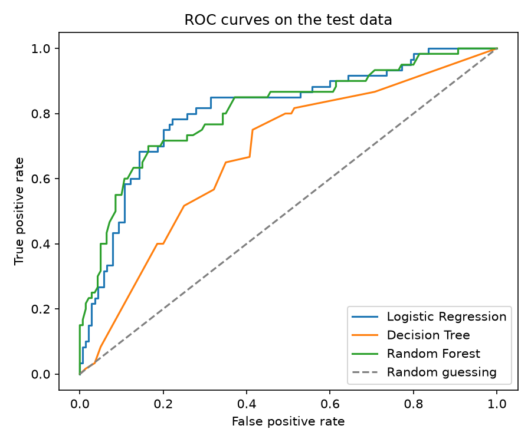
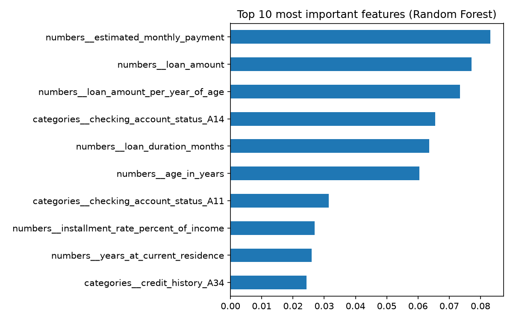

# Credit Scoring Model

This is my Task 1 project for the CodeAlpha Machine Learning internship.
The goal is to predict if a person is a good or a bad credit risk using
their past financial information.

## Project video

LinkedIn video: [PASTE YOUR LINKEDIN POST LINK HERE]

## What this project does

A bank has to decide if it should give a loan to a person. If the person
does not pay back, the bank loses money. In this project I train three
machine learning models on old loan records so they can learn which
people are more likely to be a bad credit risk.

I compare these three models:

- Logistic Regression
- Decision Tree
- Random Forest

## The data

I used the German Credit dataset from the UCI Machine Learning
Repository. It has 1000 people and 20 pieces of information about each
one, such as the loan amount, how long the loan is for, the age, the
checking account status, the credit history and the type of job. Each
person is marked as a good or a bad credit risk.

30% of the people in the data are bad credit risks (300 people), so the
data is not balanced. This matters when I read the results. The data
file is saved as `data/german.data` in this repo.

## What I did, step by step

1. **Loaded the data.** The file has no column names, so I added them
   myself using the dataset description.
2. **Made the target easy to read.** I changed the label so that 1 means
   a bad credit risk and 0 means a good one.
3. **Created new features** from the existing ones:
   - estimated monthly payment (loan amount divided by loan months)
   - loan amount per year of age
   - a flag for loans longer than 24 months
4. **Left out sex and marital status on purpose.** A real bank should
   not decide on credit using these, so I did not let my model use them.
5. **Prepared the data.** Numbers were scaled and text columns were
   turned into numbers (one-hot encoding). I did this inside a pipeline
   so the test data never leaks into the training.
6. **Split the data.** 80% for training and 20% for testing. I kept the
   same share of bad risks in both parts. The test data has 200 people:
   140 good and 60 bad.
7. **Trained the three models.** I used balanced class weights so the
   models pay more attention to the smaller group (bad risks).
8. **Checked them on the test data** with Precision, Recall, F1-Score
   and ROC-AUC.

In all the scores below, "positive" means a bad credit risk, because
that is the case the bank most wants to catch.

## Results

| Model               | Precision | Recall | F1-Score | ROC-AUC |
| ------------------- | --------- | ------ | -------- | ------- |
| Logistic Regression | 0.557     | 0.817  | 0.662    | 0.809   |
| Decision Tree       | 0.443     | 0.650  | 0.527    | 0.675   |
| Random Forest       | 0.667     | 0.633  | 0.650    | 0.808   |

What the scores mean in simple words:

- **Precision:** when the model says "bad risk", how often it is right.
- **Recall:** out of all the real bad risks, how many the model found.
- **F1-Score:** one number that balances precision and recall.
- **ROC-AUC:** how well the model separates good from bad risks. 0.5 is
  random guessing and 1.0 is perfect.

I also worked out these numbers from the confusion matrices below
(the test data has 60 bad and 140 good people):

| Model               | Accuracy | Bad risks missed (out of 60) | Good people wrongly flagged (out of 140) |
| ------------------- | -------- | ---------------------------- | ---------------------------------------- |
| Logistic Regression | 75.0%    | 11                           | 39                                       |
| Decision Tree       | 65.0%    | 21                           | 49                                       |
| Random Forest       | 79.5%    | 22                           | 19                                       |

Output of the script:

```text
Loaded 1000 people.
Share of bad credit risks: 0.3

--- Logistic Regression ---
Confusion matrix (rows = real, columns = predicted):
[[101  39]
 [ 11  49]]

--- Decision Tree ---
Confusion matrix (rows = real, columns = predicted):
[[91 49]
 [21 39]]

--- Random Forest ---
Confusion matrix (rows = real, columns = predicted):
[[121  19]
 [ 22  38]]

=== Model comparison ===
              Model  Precision  Recall  F1-Score  ROC-AUC
Logistic Regression      0.557   0.817     0.662    0.809
      Decision Tree      0.443   0.650     0.527    0.675
      Random Forest      0.667   0.633     0.650    0.808

Top 10 features for the Random Forest:
numbers__estimated_monthly_payment             0.083167
numbers__loan_amount                           0.077091
numbers__loan_amount_per_year_of_age           0.073422
categories__checking_account_status_A14        0.065454
numbers__loan_duration_months                  0.063556
numbers__age_in_years                          0.060498
categories__checking_account_status_A11        0.031425
numbers__installment_rate_percent_of_income    0.026964
numbers__years_at_current_residence            0.025959
categories__credit_history_A34                 0.024370
```

The names that start with `numbers__` are number columns, and the ones
that start with `categories__` are text columns that were turned into
yes/no columns.

### ROC curves



### Most important features (Random Forest)



## What I found

Logistic Regression found the most bad credit risks. It caught 49 of
the 60 bad people in the test data (recall 0.817) and missed 11. The
price was 39 good people wrongly flagged as bad (precision 0.557).
Random Forest went the other way: it wrongly flagged only 19 good
people (precision 0.667), but it missed 22 of the 60 bad ones (recall
0.633).

Their ROC-AUC was almost the same (0.809 and 0.808), so I cannot say one
is better at separating good from bad risks. They just sit at different
points of the same trade-off. The Decision Tree was the weakest on every
score (ROC-AUC 0.675). Its accuracy of 65% is also lower than the 70% I
would get by saying "good" to every person.

For a bank, approving someone who will not pay back usually costs more
than refusing a good customer. That is why I look at recall first, and
why Logistic Regression looks like the better choice here. A real bank
would need to put real costs on each mistake to decide properly.

For the Random Forest, the estimated monthly payment, the loan amount
and the loan amount per year of age were the top three features. Two of
these (monthly payment and loan amount per year of age) are features I
created myself. The checking account status also mattered (A14 means no
checking account and A11 means a negative balance, from the dataset
description). The importance values are close to each other, and Random
Forest importance can favour number columns, so I read this list with
care.

## Limits of this project

- The dataset is small (1000 people) and comes from one country and an
  older time, so it may not match customers today.
- I tested on one split with only 60 bad people, so one person changes
  the recall by about 1.7 points. The differences between the models are
  not very reliable.
- I did not use cross-validation or tune the models. This is a first
  working version.
- I did not give different costs to the two kinds of mistakes.
- Leaving out sex and marital status does not make the model fully fair,
  because it still uses age and whether the person is a foreign worker.

## How to run it

```
python3 -m venv .venv
source .venv/bin/activate
python -m pip install -r requirements.txt
python credit_scoring_model.py
```

The results table and the pictures are saved in the `results` folder.
Pandas may show a harmless warning about `select_dtypes`.

## Tools used

Python, pandas, NumPy, scikit-learn and Matplotlib.

## What I learned

bad training algorithim can result in to bad decision , example in a banks credit for the customers
